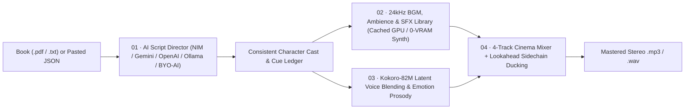

# 🎬 AudioBook-AI — Noir Cinema Audiobook Studio

<p align="center">
  <strong>A free, open-source eBook-to-Audiobook studio with consistent character voices, accent &amp; persona casting, emotional scene-continuous BGM, subtle ambience, and timed spot SFX — mastered into a single cinema-grade audio file.</strong>
</p>

<p align="center">
  
  
  
  
  
</p>

---

## ✨ What Makes AudioBook-AI Different?

Traditional audiobook tools read an entire book in one flat robotic voice—or chop background music on every sentence. **AudioBook-AI** directs your `.pdf` or `.txt` book like a full cinema audio drama:

1. **Noir Frosted-Glass Web Studio (`Zero Gradio Bloat`)**
   - Pure black-and-white frosted obsidian glass UI (`backdrop-filter` blur, custom translucent dropdowns, interactive spotlight cards).
   - Real-time **Server-Sent Events (SSE)** 4-stage pipeline tracker, Character Cast & Cue matrix, and a **60fps Web Audio `<canvas>` spectrum player** with byte-range seeking.

2. **Flexible AI Direction — Cloud APIs, Optional Local Ollama, or Zero-API "Bring Your Own AI"**
   - **NVIDIA NIM API**: Built-in support for `nvidia/nemotron-3.5-bolt-e4b`, `nvidia/nemotron-3.5-lightning-30b-a3b`, `nvidia/nemotron-3-ultra-550b-a55b`, and `nvidia/nemotron-3.5-super-vl-120b-a12b` + live model fetching.
   - **Google Gemini API & OpenAI API**: Supports `gemini-2.5-flash`, `gemini-2.5-pro`, `gpt-5-mini`, `gpt-5`, `gpt-4o`, `o4-mini`, `o3` with automatic reasoning-token (`<think>` / `thought`) stripping and inner-quote JSON repair.
   - **Ollama (100% Optional Local LLM)**: Never required unless selected; automatically unloads from VRAM (`keep_alive=0`) before audio synthesis begins.
   - **1-Click Prompt & Paste JSON (No API Key Needed!)**: Click **Copy Prompt**, attach your book directly inside ChatGPT / Claude / Gemini / Grok, and paste the returned JSON (even multi-part replies!) directly into the studio.

3. **Consistent Character Voices via Neural Latent Blending (`Kokoro-82M`)**
   - Understands freeform persona profiles (`"Gravelly, commanding British pirate"`, `"Ethereal, ancient gentle mermaid"`, `"Indian 30y man, calm"`, `"10y old curious girl"`).
   - Routes across **American** (`af_*`/`am_*`), **British** (`bf_*`/`bm_*`), and **Indian** (`hm_*`/`hf_*`) voice banks and **blends complementary voice embeddings directly in neural latent space** for crystal-clear, phase-pure expression across 30+ emotions—without robotic grain-stretching artifacts.

4. **4-Track 24 kHz Soundscape & Guaranteed Voice Clarity**
   - **Track 1 · Presence-Clear Voices**: Preserves natural emotional loudness dynamics (`whisper` vs `tender` vs `shouting`) with `78 Hz` rumble filtering and subtle condenser air.
   - **Track 2 · Scene-Continuous Emotional BGM**: 24 kHz de-hissed neural orchestral scores reinforced with pure harmonic beds and concert-hall reverb. Loops seamlessly across entire scenes (never resets per sentence!) with `1.9s` mood crossfades and `music_intensity` swells.
   - **Track 3 · Subtle Stereo Ambience**: Continuous spatial room/nature beds (`ocean_waves`, `gentle_rain`, `crackling_fireplace`, `forest_wind`, etc.).
   - **Track 4 · Sample-Accurate Timed Spot SFX**: Supports `"before"` (dramatic spotlight beat prior to dialogue), `"start"`, `"under"`, and `"after"`.
   - **Asymmetric Lookahead Sidechain Ducking**: Ducks background tracks `55ms` before every spoken word, swells naturally during dramatic pauses, and enforces a mathematical **`13.5 dB` Voice-to-Background RMS guard** so voices are never overpowered.

5. **6 GB Laptop GPU Friendly & Fast**
   - Staged sequential VRAM execution (`Script → Soundscape → Voices → Mastering`) + FP16 attention/VAE slicing (~2.3 GB peak VRAM), permanent `output/audio_library/` caching, and an instant **0 MB VRAM Procedural Synth** mode.

---

## 🏗️ Pipeline Architecture



---

## 🛠️ Installation

### 1. Clone the Repository
```powershell
git clone https://github.com/Shreyas445/AudioBook-AI.git
cd AudioBook-AI
```

### 2. Create a Virtual Environment & Install Dependencies
```powershell
python -m venv .venv
.\.venv\Scripts\activate

# Recommended for NVIDIA GPUs: install CUDA-enabled PyTorch first
pip install torch torchvision torchaudio --index-url https://download.pytorch.org/whl/cu121

# Install AudioBook-AI requirements
pip install -r requirements.txt
```

> **Optional (`FFmpeg`)**: Install [FFmpeg](https://ffmpeg.org/) (`winget install Gyan.FFmpeg`) to export compressed `192 kbps` `.mp3` files. If FFmpeg is not installed, AudioBook-AI automatically exports lossless `24 kHz` stereo `.wav` files with zero errors.

---

## 🚀 Usage

### Launch the Noir Web Studio (Recommended)
Double-click **`run_gui.bat`** or run:
```powershell
.\run_gui.bat
```
Your browser opens automatically at `http://127.0.0.1:7860`.

- **Mode 1 (`Auto-Director`)**: Select **NVIDIA NIM**, **Google Gemini**, **OpenAI**, or **Ollama**, enter your API key, drop a `.pdf` / `.txt` book (or paste text), and click **Direct & Master Audiobook**.
- **Mode 2 (`Prompt & JSON`)**: Click **Copy Prompt**, upload your story directly to ChatGPT / Claude / Gemini with that prompt, paste the JSON reply into Step 2, and click **Render Audiobook**.

### Command-Line Interface (CLI)
```powershell
# Convert a PDF using NVIDIA NIM Nemotron 3.5 Bolt
.\run.bat my_book.pdf --provider "NVIDIA NIM API" --model "nvidia/nemotron-3.5-bolt-e4b" --api-key "nvapi-..."

# Render directly from a saved or pasted JSON script
.\run.bat my_script.json --from-json

# Fast 0-VRAM procedural soundscape mode
.\run.bat my_script.json --from-json --soundscape procedural
```

---

## 📜 Production JSON Schema Example

```json
{
  "characters": [
    {
      "name": "Narrator",
      "voice_profile": "Warm cinematic adult storyteller, dramatic",
      "gender": "female",
      "age_group": "adult",
      "accent": "american",
      "voice_id": "af_heart"
    },
    {
      "name": "Elias Blackthorn",
      "voice_profile": "Gravelly, commanding pirate, determined",
      "gender": "male",
      "age_group": "adult",
      "accent": "british"
    }
  ],
  "blocks": [
    {
      "speaker": "Narrator",
      "text": "The ocean went silent beneath the silver moon.",
      "emotion": "tense",
      "bg_music": "suspense_tense",
      "music_intensity": 0.65,
      "ambience": "ocean_waves",
      "sfx": "wind_gust",
      "sfx_timing": "before",
      "pause_after_ms": 900
    },
    {
      "speaker": "Elias Blackthorn",
      "text": "Let an old pirate take the watch.",
      "emotion": "determined",
      "bg_music": "triumphant",
      "music_intensity": 0.75,
      "ambience": "ocean_waves",
      "sfx": "none",
      "sfx_timing": "before",
      "pause_after_ms": 1000
    }
  ]
}
```

---

## 📂 Project Structure

```text
AudioBook-AI/
├── app.py                   # Standalone HTTP + SSE streaming server & REST API
├── main.py                  # 4-stage GPU-efficient orchestration & CLI entry point
├── config.py                # Voice catalog, soundscape prompts & mastering constants
├── core/
│   ├── llm_client.py        # NIM, Gemini, OpenAI & Ollama client + JSON repair/salvage
│   ├── script_engine.py     # Pydantic schema, prompt builder & cast continuity
│   ├── tts_engine.py        # Kokoro-82M latent voice blending & emotion prosody
│   ├── music_engine.py      # 24kHz hybrid AudioLDM 2 + CLAP soundscape engine
│   ├── procedural_audio.py  # 0-VRAM 24kHz harmonic score, ambience & foley synth
│   └── studio.py            # 4-track stereo mixer & asymmetric lookahead ducking
├── utils/
│   └── text_utils.py        # Recursive PDF/TXT cleaner & paragraph/sentence chunker
├── web/
│   ├── index.html           # Noir frosted-glass Studio layout
│   ├── styles.css           # Monochrome glassmorphism & custom frosted dropdowns
│   └── app.js               # Live SSE client & 60fps Web Audio spectrum player
├── .env.example             # Safe environment variable template (no keys)
├── run_gui.bat              # One-click Windows Studio launcher
└── run.bat                  # CLI launcher
```

---

## 🔐 Security & API Key Privacy

- Keys saved via **"Remember key"** in the Studio UI are stored exclusively in `.env.local`, which is strictly excluded by `.gitignore`.
- Run `.\prepare_github.bat` before committing to connect/sync your local folder with GitHub and automatically verify that zero API keys or `.env` files are staged.
