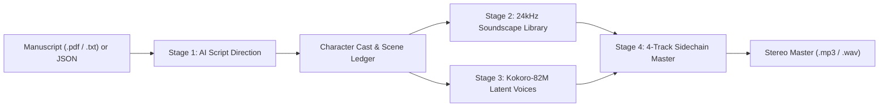

<div align="center">

# AudioBook-AI

**Open-Source Multi-Speaker Cinema Audiobook & Spatial Soundscape Engine**

[](https://www.python.org/)
[](https://pytorch.org/)
[](https://huggingface.co/hexgrad/Kokoro-82M)
[](https://huggingface.co/cvssp/audioldm2)
[](LICENSE)

[Overview](#overview) •
[Architecture](#architecture) •
[Installation](#installation) •
[Quick Start](#quick-start) •
[CLI Reference](#cli-reference) •
[JSON Specification](#json-specification) •
[Security](#security--privacy)

</div>

---

## Overview

**AudioBook-AI** converts `.pdf` and `.txt` manuscripts into mastered, multi-character audiobooks with scene-continuous musical scores, environmental ambience, and synchronized spot sound effects—exported as a single stereo `.mp3` or lossless `.wav` file.

Unlike single-voice text-to-speech readers or pipelines that restart background tracks on every sentence, AudioBook-AI separates production into four dedicated stages: **LLM Script Direction**, **24 kHz Soundscape Synthesis**, **Latent-Blended Neural Voice Generation**, and **Broadcast Sidechain Mastering**. Sequential GPU memory management keeps peak VRAM usage around ~2.3 GB, allowing full neural production on consumer 6 GB laptop GPUs.

---

## Key Capabilities

| Subsystem | Technical Implementation |
| :--- | :--- |
| **Web Studio Interface** | Standalone zero-framework HTTP + Server-Sent Events (SSE) server (`app.py`) paired with a monochrome frosted-glass web client, real-time 4-stage telemetry, cast matrix, and a 60 fps Web Audio `<canvas>` spectrum player with HTTP `206` byte-range seeking. |
| **Multi-Provider AI Direction** | Native support for **NVIDIA NIM** (`nemotron-3.5-bolt-e4b`, `nemotron-3.5-lightning-30b-a3b`, `nemotron-3-ultra-550b-a55b`), **Google Gemini**, **OpenAI**, and optional local **Ollama**. Includes automatic chain-of-thought (`<think>`) stripping, inner-quote JSON repair, and truncation recovery. |
| **External AI ("Prompt & JSON")** | Built-in story-free Master Director Prompt generator. Users can attach manuscripts directly in ChatGPT, Claude, or Gemini, copy the prompt in one click, and paste single or multi-part JSON responses for direct audio rendering without API keys. |
| **Character Voice Synthesis** | Powered by **Kokoro-82M** across American (`af_*`/`am_*`), British (`bf_*`/`bm_*`), and Indian (`hm_*`/`hf_*`) voice banks. Blends style embeddings directly in neural latent space for distinct character timbres without grain time-stretching artifacts, alongside 30+ emotional prosody profiles. |
| **4-Track Spatial Mastering** | Combines center-panned dialogue, scene-grouped continuous BGM (`1.9s` equal-power mood crossfades and intensity automation), stereo Haas-widened ambience, and sample-accurate timed SFX (`before`, `start`, `under`, `after`). |
| **Broadcast Voice Clarity** | Applies `78 Hz` high-pass rumble filtering, `2.1 kHz` vocal-pocket EQ carving on background buses, `55 ms` lookahead asymmetric sidechain ducking, and a mathematical `13.5 dB` minimum Voice-to-Background RMS ratio guard. |

---

## Architecture



### Staged GPU Memory Lifecycle

1. **Stage 1 — Script Direction**: Splits text along paragraph and sentence boundaries, maintains a persistent character-to-voice registry across chunks, checkpoints the structured script to `output/scripts/`, and unloads local LLM weights (`keep_alive=0`) when Ollama is used.
2. **Stage 2 — Deduplicated Soundscape Pre-Generation**: Scans the full script upfront to identify unique BGM themes, ambiences, and SFX cues. Generates only uncached assets using FP16 attention/VAE slicing and CLAP candidate ranking, masters them to `24 kHz` in `output/audio_library/`, and immediately unloads `AudioLDM 2` from VRAM.
3. **Stage 3 — Neural Voice Synthesis**: Allocates full GPU headroom to `Kokoro-82M` (`torch.inference_mode()`), applying latent voice blending, demographic routing, and per-line emotional loudness dynamics.
4. **Stage 4 — Vectorized Stereo Mixing**: Assembles all four buses in `float32` at `24,000 Hz` with asymmetric attack/release sidechain ducking and exports `192 kbps` stereo MP3 (or `16-bit` PCM WAV if FFmpeg is absent).

---

## Installation

### Prerequisites

- **Python**: `3.10` – `3.12`
- **GPU (Recommended)**: NVIDIA GPU with CUDA support (6 GB+ VRAM recommended for Neural Soundscape mode; 0 MB VRAM Procedural mode also included)
- **FFmpeg (Optional)**: Required only for `.mp3` encoding (`winget install Gyan.FFmpeg` on Windows, `brew install ffmpeg` on macOS, or `apt install ffmpeg` on Linux). Falls back automatically to lossless `.wav` if not installed.

### Setup

```powershell
# 1. Clone the repository
git clone https://github.com/Shreyas445/AudioBook-AI.git
cd AudioBook-AI

# 2. Create and activate a virtual environment
python -m venv .venv
.\.venv\Scripts\activate          # Windows
# source .venv/bin/activate       # Linux / macOS

# 3. Install PyTorch with CUDA support (recommended for NVIDIA GPUs)
pip install torch torchvision torchaudio --index-url https://download.pytorch.org/whl/cu121

# 4. Install project dependencies
pip install -r requirements.txt
```

---

## Quick Start

### 1. Web Studio Application

On Windows, launch via the included batch script:

```powershell
.\run_gui.bat
```

Or run directly with Python on any platform:

```bash
python app.py
```

The studio starts on `http://127.0.0.1:7860` and opens automatically in your default browser.

- **Auto-Director Workflow**: Choose an AI provider (**NVIDIA NIM**, **Google Gemini**, **OpenAI**, or **Ollama**), provide an API key if using a cloud endpoint, attach a `.pdf`/`.txt` manuscript (or paste text), and click **Direct & Master Audiobook**.
- **Prompt & JSON Workflow (No API Key Required)**: Switch to **Prompt & JSON**, click **Copy Prompt**, upload your story directly to any external AI assistant alongside that prompt, paste the resulting JSON into Step 2, and click **Render Audiobook**.

### 2. Environment Configuration (Optional)

Copy `.env.example` to `.env.local` to pre-configure credentials locally:

| Variable | Description | Default |
| :--- | :--- | :--- |
| `NVIDIA_API_KEY` | API key from [build.nvidia.com](https://build.nvidia.com) for NIM models | — |
| `GEMINI_API_KEY` | API key from [Google AI Studio](https://aistudio.google.com) | — |
| `OPENAI_API_KEY` | API key from [OpenAI Platform](https://platform.openai.com) | — |
| `OLLAMA_URL` | Local Ollama server endpoint (used only when Ollama is selected) | `http://localhost:11434` |
| `PORT` | Local HTTP port for the Web Studio | `7860` |

---

## CLI Reference

```powershell
python main.py <input_file> [options]
```

| Argument / Flag | Description |
| :--- | :--- |
| `input_file` | Path to `.txt`, `.pdf`, or `.json` production script file. |
| `--provider` | `"NVIDIA NIM API"`, `"Google Gemini API"`, `"OpenAI API"`, or `"Ollama (Local - Optional)"`. |
| `--model` | Model identifier (e.g., `nvidia/nemotron-3.5-bolt-e4b`, `gemini-2.5-flash`, `gpt-5-mini`). |
| `--api-key` | Explicit API key (overrides environment variables). |
| `--from-json` | Renders audio directly from a pre-generated `.json` script file, skipping Stage 1. |
| `--export-prompt` | Exports copyable AI Director prompt part(s) to `output/scripts/` without calling an API. |
| `--soundscape` | `neural` (AudioLDM 2 GPU cached), `procedural` (0-VRAM studio synth), or `none` (voice only). |

**Examples:**

```powershell
# Full conversion using NVIDIA NIM
.\run.bat novel.pdf --provider "NVIDIA NIM API" --model "nvidia/nemotron-3.5-lightning-30b-a3b"

# Render directly from a saved JSON script using zero-VRAM procedural soundscape
.\run.bat my_script.json --from-json --soundscape procedural
```

---

## JSON Specification

Scripts adhere to the `ProductionScript` schema (`core/script_engine.py`):

```json
{
  "characters": [
    {
      "name": "Narrator",
      "voice_profile": "Warm cinematic adult storyteller, dramatic",
      "gender": "female",
      "age_group": "adult",
      "accent": "american",
      "voice_id": "af_heart"
    },
    {
      "name": "Elias Blackthorn",
      "voice_profile": "Gravelly, commanding pirate, determined",
      "gender": "male",
      "age_group": "adult",
      "accent": "british"
    }
  ],
  "blocks": [
    {
      "speaker": "Narrator",
      "text": "The ocean went silent beneath the silver moon.",
      "emotion": "tense",
      "bg_music": "suspense_tense",
      "music_intensity": 0.65,
      "ambience": "ocean_waves",
      "sfx": "wind_gust",
      "sfx_timing": "before",
      "pause_after_ms": 900
    }
  ]
}
```

### Block Field Reference

| Field | Type | Supported Values / Behavior |
| :--- | :--- | :--- |
| `speaker` | `string` | Character name; matched case-insensitively to `characters[]` for consistent casting. |
| `text` | `string` | Spoken narration or dialogue line (Markdown emphasis is automatically stripped). |
| `voice_profile` | `string` | Freeform vocal persona (e.g., `"Indian 30y man, calm"`, `"10y curious girl"`, `"grumpy British captain"`). |
| `accent` | `string` | `"american"`, `"british"`, or `"indian"` (auto-inferred from `voice_profile` if omitted). |
| `age_group` | `string` | `"child"`, `"teen"`, `"young_adult"`, `"adult"`, or `"elderly"`. |
| `emotion` | `string` | `"neutral"`, `"happy"`, `"excited"`, `"sad"`, `"tender"`, `"angry"`, `"shouting"`, `"grumpy"`, `"sarcastic"`, `"whisper"`, `"fearful"`, `"tense"`, `"determined"`, `"dramatic"`, `"awe"`, `"ethereal"`. |
| `bg_music` | `string` | `"peaceful_calm"`, `"happy"`, `"warm_heartfelt"`, `"sad_emotional"`, `"suspense_tense"`, `"intense"`, `"epic_action"`, `"mystery"`, `"dark_ominous"`, `"romantic"`, `"playful_whimsical"`, `"triumphant"`, `"none"`, or custom mood phrase. |
| `music_intensity` | `float` | `0.0` – `1.0` dynamic expression curve within active scenes. |
| `ambience` | `string` | `"ocean_waves"`, `"gentle_rain"`, `"thunderstorm"`, `"forest_wind"`, `"night_crickets"`, `"crackling_fireplace"`, `"busy_cafe"`, `"city_street"`, `"castle_hall"`, `"spaceship_hum"`, or `"none"`. |
| `sfx` | `string` | `"thunder_clap"`, `"door_creak"`, `"door_slam"`, `"door_knock"`, `"footsteps_slow"`, `"footsteps_running"`, `"glass_shatter"`, `"sword_clash"`, `"heartbeat"`, `"phone_ring"`, `"car_engine"`, `"wind_gust"`, `"sigh_gasp"`, `"magic_chime"`, or `"none"`. |
| `sfx_timing` | `string` | `"before"` (inserts dramatic pre-beat), `"start"` (at line onset), `"under"` (looped softly under speech), or `"after"` (post-line beat). |
| `pause_after_ms` | `int` | Post-line silence in milliseconds (`80` – `2500`), covered continuously by scene BGM and ambience. |

---

## Project Layout

```text
AudioBook-AI/
├── app.py                   # ThreadingHTTPServer + SSE job streaming + byte-range audio server
├── main.py                  # 4-stage sequential GPU pipeline & CLI entry point
├── config.py                # Voice catalog, soundscape prompts & broadcast mastering targets
├── core/
│   ├── llm_client.py        # Multi-provider HTTP client, reasoning filter & JSON repair engine
│   ├── script_engine.py     # Pydantic v2 models, prompt generator & cast continuity
│   ├── tts_engine.py        # Kokoro-82M latent voice blending & prosody shaping
│   ├── music_engine.py      # 24kHz hybrid AudioLDM 2 + CLAP soundscape cache manager
│   ├── procedural_audio.py  # Zero-VRAM 24kHz harmonic score, ambience & foley synthesizer
│   └── studio.py            # Vectorized 4-track stereo mixer & asymmetric lookahead ducking
├── utils/
│   └── text_utils.py        # PDF header stripper & recursive paragraph/sentence chunker
├── web/
│   ├── index.html           # Monochrome frosted-glass Web Studio markup
│   ├── styles.css           # Glassmorphic styling & custom translucent dropdown system
│   └── app.js               # SSE client, cast/cue inspector & Web Audio spectrum analyzer
├── .env.example             # Environment variable template
├── prepare_github.bat       # Git remote sync & pre-commit API-key scanner
├── run_gui.bat              # Windows Web Studio launcher
└── run.bat                  # Windows CLI launcher
```

---

## Security & Privacy

- API keys saved with **Remember key** in the Web Studio are written only to `.env.local`, which is ignored by Git via `.gitignore`.
- Uploaded manuscripts (`output/uploads/`), generated scripts (`output/scripts/`), and rendered audio (`output/`) remain strictly local on your machine.
- Run `.\prepare_github.bat` prior to committing to verify staged diffs against accidental credential patterns (`nvapi-`, `AIza`, `sk-`).

---

## License

Released under the [MIT License](LICENSE).
